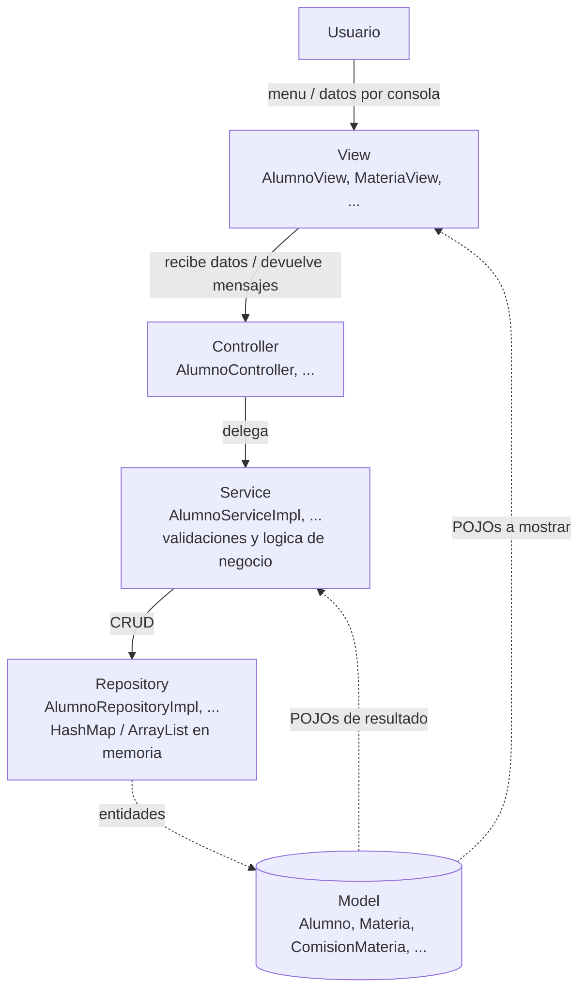

# Backoffice Académico - ITEC N°1

Proyecto final: sistema de gestión académica para consola (backoffice), desarrollado en Java puro siguiendo una arquitectura en capas estricta, sin frameworks ni interfaz gráfica.

## Descripción

El sistema permite administrar el ciclo académico completo de un instituto desde la línea de comandos:

- **Gestión de personas**: altas, bajas lógicas, búsqueda y listado de Alumnos y Profesores.
- **Oferta académica**: Materias (con materias correlativas), Carreras y Planes de Estudio.
- **Dictado**: Comisiones por cuatrimestre con profesor asignado e inscripción de alumnos.
- **Seguimiento**: carga de Notas por tipo de evaluación (con promoción automática a APROBADO si el promedio es ≥ 6) y registro de Asistencias (presente/ausente por fecha).

Al arrancar, el sistema carga un set de datos de demostración (`DataSeeder`) con alumnos, profesores, materias, comisiones, carreras y planes ya vinculados, para poder operar de inmediato.

## Tecnologías

| Tecnología | Uso |
|---|---|
| **Java 17 (JDK)** | Lenguaje y librería estándar únicamente (sin Spring, Hibernate ni Lombok) |
| **Maven 3.9** (con Maven Wrapper) | Gestión del build, sin dependencias externas |
| **Persistencia en memoria** | `HashMap` y `ArrayList` estáticos dentro de las clases Repository, simulando tablas de una base de datos |
| **Interfaz de usuario** | Consola: menús con `System.out` y lectura con `Scanner` |

## Compilación y ejecución

Requisito previo: tener **JDK 17** instalado. Maven no es necesario: el proyecto incluye el **Maven Wrapper**.

```bash
# Compilar y ejecutar (Linux/Mac)
./mvnw clean compile exec:java

# Compilar y ejecutar (Windows)
.\mvnw.cmd clean compile exec:java

# Generar el JAR ejecutable
./mvnw clean package
java -jar target/backoffice-academico.jar
```

Al iniciar, se despliega el menú principal:

```
############################
#  BACKOFFICE ACADEMICO    #
############################
1. Gestion de Alumnos
2. Gestion de Profesores
3. Gestion de Materias
4. Comisiones e Inscripciones
5. Notas
6. Asistencias
7. Gestion de Carreras
0. Salir
```

## Arquitectura

El proyecto aplica un patrón **MVC en capas**, con una capa de **Service** intermedia y el patrón **Interface-Impl** en las capas Service y Repository.

### Capas y responsabilidades

| Capa | Paquete | Responsabilidad | Regla clave |
|---|---|---|---|
| **View** | `view` | Menús de consola (`System.out` + `Scanner` vía `ConsoleInput`, un único `Scanner` compartido) | Solo conoce a los **Controllers** |
| **Controller** | `controller` | Orquestación: recibe datos de la vista y delega en el service (controladores "delgados") | Solo conoce a los **Services** |
| **Service** | `service` | Lógica de negocio pura: validaciones, reglas académicas, mensajes de resultado | Solo conoce a los **Repositories** |
| **Repository** | `repository` | Persistencia en memoria (`HashMap`/`ArrayList` estáticos), operaciones CRUD | No conoce a nadie |
| **Model** | `model` | Entidades POJO y enums del dominio académico | Solo datos (con copia defensiva de listas) |

### Patrón Interface-Impl

Tanto los services como los repositorios se definen mediante una **interfaz** (`AlumnoService`, `AlumnoRepository`, ...) y su implementación concreta termina en `Impl` (`AlumnoServiceImpl`, `AlumnoRepositoryImpl`, ...). Consecuencias:

- Las capas altas dependen de **contratos**, no de implementaciones.
- Cambiar la estrategia de persistencia (por ejemplo, a archivo o a una BD real) solo exige escribir un nuevo `*RepositoryImpl` y modificar una línea del `Main`.
- Facilita el testing aislado de cada capa.

### Inyección de Dependencias

No se usa ningún framework: la inyección es **por constructor y manual**, y ocurre en un único punto, el `Main` (composition root), de abajo hacia arriba:

```java
AlumnoRepository repo = new AlumnoRepositoryImpl();          // implementación concreta
AlumnoService service = new AlumnoServiceImpl(repo);         // impl recibe la interfaz del repo
AlumnoController controller = new AlumnoController(service); // controller recibe la interfaz del service
AlumnoView view = new AlumnoView(controller);                // view recibe el controller
```

`Main` es la única clase que conoce las implementaciones concretas; el resto del sistema trabaja solo con interfaces.

### Diagrama de flujo



## Funcionalidades implementadas

### 1. Gestión de Alumnos
- Crear alumno (valida DNI único, mail con `@`, campos obligatorios).
- Buscar por DNI.
- Listar todos (DNI, nombre completo, mail, estado).
- Baja **lógica** (activo/inactivo; rechaza doble baja).

### 2. Gestión de Profesores
- Crear, buscar por DNI, listar y baja lógica (mismo patrón que Alumnos).

### 3. Gestión de Materias
- Crear (nombre único, año y cuatrimestre válidos), activa por defecto.
- Buscar por nombre, listar todas (con estado y correlativas).
- Modificar (renombrado con re-claveo en el repositorio; valida colisiones).
- Baja lógica.
- **Materias correlativas** (relación reflexiva del UML): no puede ser correlativa de sí misma ni duplicarse.

### 4. Comisiones e Inscripciones
- Crear comisión: materia activa + cuatrimestre (fechas) + profesor activo; ID autoincremental; valida duplicados.
- Listar comisiones.
- Inscribir alumno activo en comisión existente (estado inicial `REGULAR`; rechaza duplicados).

### 5. Notas
- Cargar nota (0 a 10) por tipo de evaluación (TP, PARCIAL, RECUPERATORIO, FINAL).
- Crea el `Examen` y la `Nota` vinculados al `AlumnoInscripto`.
- Calcula el promedio y **promociona a APROBADO** si es ≥ 6 (guardando la nota final).

### 6. Asistencias
- Registrar presente/ausente de un alumno inscripto, con fecha del día.
- Listar asistencias por comisión (fecha, estado, alumno).

### 7. Carreras y Planes de Estudio
- Crear carreras (nombre único).
- Crear planes de estudio por carrera (rango de años; valida coherencia).
- Asociar materias existentes a un plan (valida existencia y duplicados).
- Listado jerárquico: **Carrera → Plan → Materias** (con año, cuatrimestre, estado y correlativas).

## Estructura del proyecto

```
src/main/java/com/itec/
├── Main.java          # Composition root: cableado de implementaciones
├── config/            # DataSeeder (datos de demostración)
├── model/             # 11 entidades POJO + 2 enums
├── repository/        # Interfaces + Impl (HashMap/ArrayList estáticos)
├── service/           # Interfaces + Impl (lógica de negocio)
├── controller/        # Controladores delgados
└── view/              # Menús de consola + ConsoleInput (Scanner único)
```

## Próximos Pasos (Roadmap)

El sistema está preparado para escalar hacia los requerimientos del **Anexo** del enunciado, gracias a la arquitectura por capas con Interface-Impl: cada nueva funcionalidad entra como un nuevo `Service` + `Repository` cableado en el `Main`, sin alterar lo existente.

| Módulo futuro | Descripción | Preparación actual |
|---|---|---|
| **Auditoría** | Registro de quién modificó qué y cuándo (trazabilidad de operaciones) | Las reglas de negocio ya están centralizadas en los `*ServiceImpl`: es el punto natural para emitir eventos de auditoría |
| **Reportes** | Estadísticas académicas (inscriptos por comisión, aprobados, ausentismo) | Los repositorios ya exponen `obtenerTodos()` con copias defensivas; un `ReporteService` puede agregarse sobre las interfaces existentes |
| **Actas** | Generación de actas de final/cursada por comisión | El modelo ya vincula `AlumnoInscripto` → `Examen`/`Nota` con estado `APROBADO`; falta el servicio de armado de documento |

También queda como mejora técnica natural: reemplazar la persistencia en memoria por una implementación de repositorio sobre archivo o base de datos — solo requiere escribir los nuevos `*RepositoryImpl` y cambiar el cableado en el `Main`.
